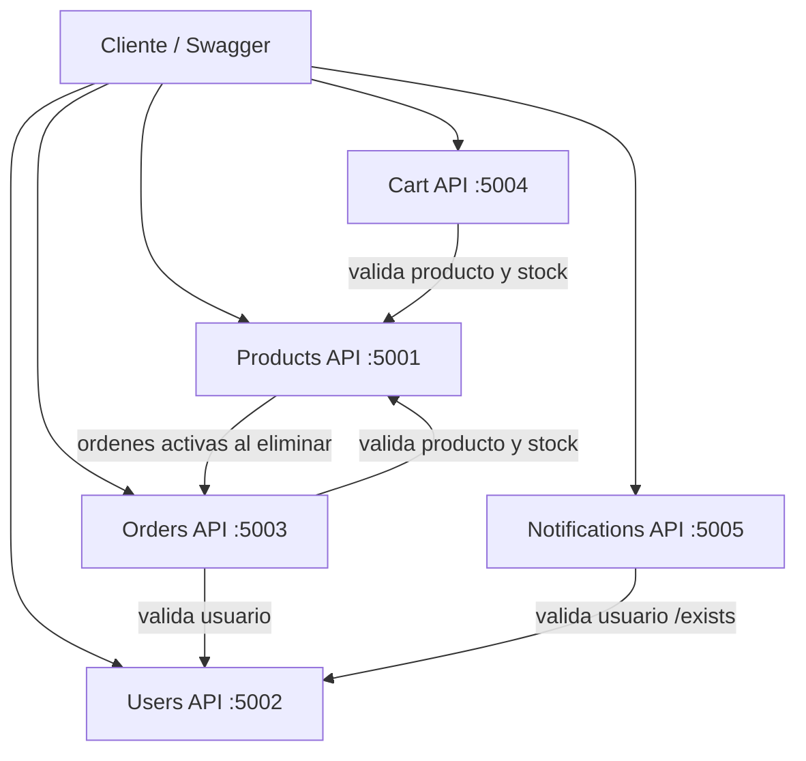

# E-Commerce con Arquitectura de Microservicios

Trabajo practico grupal de **Arquitectura y Diseño de Software**, desarrollado con **C# y .NET 10**.

El proyecto implementa un sistema de comercio electronico compuesto por APIs REST independientes para la gestion de productos, usuarios, ordenes, carritos y notificaciones. Cada microservicio posee su propia responsabilidad, documentacion Swagger, persistencia, manejo global de errores, logs estructurados, Correlation ID y Health Checks.

## Integrantes: Cristian Federico Rizzo, Valentino Mercero, Tomás Roberto (GRUPO 14)


## Tecnologias utilizadas

- C#
- .NET 10 / ASP.NET Core Web API (Controllers y Minimal APIs)
- Swagger / OpenAPI con Swashbuckle
- Serilog para logs estructurados
- `IExceptionHandler` y Problem Details para el manejo global de errores
- Data Annotations para validaciones
- `IHttpClientFactory` para la comunicacion entre microservicios
- SQLite para persistencia local
- Health Checks de ASP.NET Core
- Git y GitHub

## Arquitectura



Cada API se ejecuta como un proceso independiente. Las comunicaciones internas se realizan mediante HTTP y propagan el encabezado `X-Correlation-Id` para poder seguir una operacion entre distintos servicios.

## Microservicios y puertos

| Microservicio | Puerto | Swagger |
|---|---:|---|
| Products API | `5001` | `http://localhost:5001/swagger` |
| Users API | `5002` | `http://localhost:5002/swagger` |
| Orders API | `5003` | `http://localhost:5003/swagger` |
| Cart API | `5004` | `http://localhost:5004/swagger` |
| Notifications API | `5005` | `http://localhost:5005/swagger` |

## Funcionalidades

### Products API

Administra el catalogo de productos, permite filtrar por nombre o categoria y valida si un producto puede eliminarse consultando las ordenes activas.

| Metodo | Endpoint | Descripcion | Respuestas principales |
|---|---|---|---|
| `GET` | `/api/products` | Lista productos. Admite `?categoria=` y `?nombre=` | `200`, `500` |
| `GET` | `/api/products/{id}` | Obtiene un producto por ID | `200`, `404`, `500` |
| `POST` | `/api/products` | Crea un producto | `201`, `400`, `409`, `500` |
| `PUT` | `/api/products/{id}` | Actualiza un producto | `200`, `400`, `404`, `500` |
| `DELETE` | `/api/products/{id}` | Elimina un producto sin ordenes activas | `204`, `404`, `409`, `500` |

### Users API

Registra y autentica usuarios. Luego de tres intentos fallidos consecutivos el usuario queda bloqueado. El campo `PasswordHash` nunca se expone en las respuestas.

Ademas de los endpoints requeridos por la consigna, el grupo incorporo dos endpoints de consulta por ID, necesarios para la integracion: `GET /api/users/{id}` (lo usa Orders para validar el usuario, devuelve `404 USR-007` si no existe) y `GET /api/users/{id}/exists` (lo usa Notifications, devuelve `true` o `false`).

| Metodo | Endpoint | Descripcion | Respuestas principales |
|---|---|---|---|
| `GET` | `/api/users/{id}` | Obtiene un usuario por ID (agregado por el grupo) | `200`, `404`, `500` |
| `GET` | `/api/users/{id}/exists` | Indica si existe el usuario (agregado por el grupo) | `200`, `500` |
| `POST` | `/api/users/register` | Registra un usuario | `201`, `400`, `409`, `500` |
| `POST` | `/api/users/login` | Autentica mediante email y contrasena | `200`, `400`, `401`, `403`, `500` |

### Orders API

Administra las ordenes de compra. Al crear una orden valida la existencia del usuario, los productos solicitados y el stock disponible.

| Metodo | Endpoint | Descripcion | Respuestas principales |
|---|---|---|---|
| `GET` | `/api/orders` | Lista ordenes. Admite `?usuarioId=` | `200`, `500` |
| `GET` | `/api/orders/{id}` | Obtiene una orden por ID | `200`, `404`, `500` |
| `POST` | `/api/orders` | Crea una orden | `201`, `400`, `404`, `409`, `422`, `500` |
| `PUT` | `/api/orders/{id}/status` | Actualiza el estado de una orden | `200`, `400`, `404`, `409`, `500` |

Estados posibles: `Pendiente`, `Confirmada`, `Enviada`, `Entregada` y `Cancelada`.

### Cart API

Administra el carrito de cada usuario y consulta Products API para validar la existencia y el stock de los productos.

| Metodo | Endpoint | Descripcion | Respuestas principales |
|---|---|---|---|
| `GET` | `/api/cart/{userId}` | Obtiene el carrito de un usuario | `200`, `404`, `500` |
| `POST` | `/api/cart/{userId}/items` | Agrega un producto | `200`, `400`, `404`, `422`, `500` |
| `PUT` | `/api/cart/{userId}/items/{productId}` | Actualiza la cantidad de un producto | `200`, `400`, `404`, `422`, `500` |
| `DELETE` | `/api/cart/{userId}/items/{productId}` | Quita un producto | `204`, `404`, `500` |
| `DELETE` | `/api/cart/{userId}` | Vacia el carrito | `204`, `404`, `500` |

### Notifications API

Registra y simula el envio de notificaciones. Antes de enviar una notificacion consulta Users API para validar que el destinatario exista.

| Metodo | Endpoint | Descripcion | Respuestas principales |
|---|---|---|---|
| `POST` | `/api/notifications/send` | Registra y simula el envio | `201`, `400`, `404`, `500` |
| `GET` | `/api/notifications/{userId}` | Lista las notificaciones de un usuario | `200`, `404`, `500` |

Tipos admitidos: `Email`, `Push` y `SMS`.

## Como ejecutar el proyecto

### Requisitos previos

- [.NET 10 SDK](https://dotnet.microsoft.com/download)
- Git
- Un navegador web

### 1. Clonar el repositorio

```bash
git clone https://github.com/crizzo1408/CAI-TP-GRUPO-14.git
cd CAI-TP-GRUPO-14
```

### 2. Restaurar dependencias

Desde la raiz del repositorio:

```bash
dotnet restore MiniApi.slnx
```

### 3. Compilar la solucion

```bash
dotnet build MiniApi.slnx
```

La compilacion debe finalizar sin errores antes de iniciar los servicios.

### 4. Levantar los microservicios

Abrir una terminal independiente para cada API y ejecutar:

```bash
dotnet run --project src/Products.API/Products.API.csproj
```

```bash
dotnet run --project src/Users.API/Users.API.csproj
```

```bash
dotnet run --project src/Orders.API/Orders.API.csproj
```

```bash
dotnet run --project src/Cart.API/Cart.API.csproj
```

```bash
dotnet run --project src/Notifications.API/Notifications.API.csproj
```

Los servicios que realizan integraciones necesitan que las APIs consultadas tambien esten ejecutandose:

- Orders API necesita Products API y Users API.
- Cart API necesita Products API.
- Notifications API necesita Users API.
- Products API consulta Orders API al intentar eliminar un producto.

### 5. Abrir Swagger

Con los servicios ejecutandose, ingresar a las direcciones indicadas en la tabla de puertos. Por ejemplo:

```text
http://localhost:5001/swagger
```

Swagger permite consultar la documentacion y probar respuestas exitosas y de error sin utilizar herramientas externas.

## Health Checks

Cada microservicio expone los siguientes endpoints:

| Endpoint | Descripcion |
|---|---|
| `GET /health` | Estado general del servicio |
| `GET /health/ready` | Indica si esta listo para recibir solicitudes |
| `GET /health/live` | Indica si el proceso esta activo |

Las respuestas informan alguno de estos estados: `Healthy`, `Degraded` o `Unhealthy`.

Ejemplo para Products API:

```text
http://localhost:5001/health
http://localhost:5001/health/ready
http://localhost:5001/health/live
```

## Manejo de errores

Los errores se manejan globalmente mediante `IExceptionHandler`. Las respuestas utilizan Problem Details y no exponen stack traces.

Ejemplo:

```json
{
  "type": "https://tools.ietf.org/html/rfc7231#section-6.5.4",
  "title": "Not Found",
  "status": 404,
  "detail": "El recurso solicitado no fue encontrado.",
  "instance": "/api/products/11111111-1111-1111-1111-111111111111",
  "errorCode": "PRD-001",
  "errorMessage": "Producto no encontrado.",
  "correlationId": "2c8acb64-41f8-4331-83c8-dd5a0bf5eb91"
}
```

## Catalogo de codigos de error

### Products API

| Codigo | HTTP | Descripcion |
|---|---:|---|
| `PRD-001` | `404` | Producto no encontrado |
| `PRD-002` | `400` | Datos del producto invalidos |
| `PRD-003` | `409` | Producto duplicado en la categoria |
| `PRD-004` | `409` | El producto tiene ordenes activas y no puede eliminarse |
| `PRD-005` | `500` | Error interno al procesar el producto |

### Users API

| Codigo | HTTP | Descripcion |
|---|---:|---|
| `USR-001` | `409` | El email ya esta registrado |
| `USR-002` | `400` | Datos del usuario invalidos |
| `USR-003` | `401` | Credenciales incorrectas |
| `USR-004` | `403` | Usuario bloqueado por intentos fallidos |
| `USR-005` | `403` | Usuario bloqueado por deteccion de fraude |
| `USR-006` | `500` | Error interno al procesar el usuario |
| `USR-007` | `404` | Usuario no encontrado (extension del grupo, usado por `GET /api/users/{id}`) |

### Orders API

| Codigo | HTTP | Descripcion |
|---|---:|---|
| `ORD-001` | `404` | Orden no encontrada |
| `ORD-002` | `400` | Datos de la orden invalidos |
| `ORD-003` | `404` | Usuario no encontrado |
| `ORD-004` | `404` | Producto no encontrado |
| `ORD-005` | `422` | Stock insuficiente |
| `ORD-006` | `409` | Transicion de estado invalida |
| `ORD-007` | `500` | Error interno al procesar la orden |

### Cart API

| Codigo | HTTP | Descripcion |
|---|---:|---|
| `CRT-001` | `404` | Carrito no encontrado |
| `CRT-002` | `404` | Producto no encontrado |
| `CRT-003` | `422` | Stock insuficiente |
| `CRT-004` | `400` | Cantidad invalida |
| `CRT-005` | `500` | Error interno al procesar el carrito |

### Notifications API

| Codigo | HTTP | Descripcion |
|---|---:|---|
| `NTF-001` | `404` | Usuario no encontrado |
| `NTF-002` | `400` | Datos de la notificacion invalidos |
| `NTF-003` | `404` | No se encontraron notificaciones para el usuario |
| `NTF-004` | `500` | Error interno al procesar la notificacion |

## Logging y observabilidad

Serilog registra los eventos en:

- Consola, con formato legible.
- Archivos JSON estructurados dentro de las carpetas `logs`.

Los logs incluyen:

- Fecha y hora.
- Nivel del evento.
- Nombre del servicio.
- Endpoint solicitado.
- Correlation ID.
- Codigo de error cuando corresponde.
- Inicio y finalizacion de cada request.
- Estado HTTP final y duracion.

Los errores de negocio se registran como `Warning` y los errores inesperados como `Error`.

## Correlation ID

Cada solicitud recibe un identificador unico en el encabezado:

```text
X-Correlation-Id
```

Si el cliente envia un identificador, el servicio lo conserva. Si no lo envia, la API genera uno nuevo. El mismo valor se utiliza en los logs, en las llamadas HTTP entre microservicios, en el header de respuesta y en las respuestas de error.

Esto permite seguir una misma operacion desde su ingreso hasta su finalizacion, incluso cuando intervienen varias APIs.

## Persistencia

Cada microservicio administra sus propios datos y no accede directamente a la base de otro servicio. Las integraciones se realizan exclusivamente mediante solicitudes HTTP.

Los datos persisten luego de reiniciar las APIs, por lo que los registros creados desde Swagger se conservan entre ejecuciones.

## Estructura general

```text
CAI-TP-GRUPO-14/
|-- src/
|   |-- Products.API/
|   |-- Users.API/
|   |-- Orders.API/
|   |-- Cart.API/
|   `-- Notifications.API/
|-- docs/
|-- README.md
`-- MiniApi.slnx
```

Dentro de cada API se separan las responsabilidades en modelos, DTOs, persistencia, clientes HTTP, endpoints, excepciones, handlers, middleware, health checks y configuracion.

## Pruebas recomendadas para la demostracion

1. Consultar el estado de cada API mediante `/health`, `/health/ready` y `/health/live`.
2. Registrar un usuario y probar un inicio de sesion correcto.
3. Probar tres contrasenas incorrectas y verificar el bloqueo del usuario.
4. Consultar un usuario por ID y verificar si existe mediante los endpoints agregados por el grupo.
5. Crear un producto y consultar el producto por ID.
6. Enviar datos invalidos y verificar el codigo `PRD-002`.
7. Crear una orden y comprobar las validaciones de usuario, producto y stock.
8. Intentar eliminar un producto con ordenes activas y verificar `PRD-004`.
9. Agregar y actualizar productos en un carrito.
10. Enviar una notificacion y consultar su persistencia.
11. Verificar que las respuestas y los logs compartan el mismo Correlation ID.
12. Verificar que un error de negocio produzca el estado HTTP real sin falsos errores `500` ni stack traces.

## Capturas de Swagger UI

Las capturas de Swagger UI con ejemplos de respuestas de error (`errorCode` y `errorMessage`) se encuentran en la carpeta [`docs/Captura Errores`]

Incluyen errores de cada microservicio, pruebas de integracion entre servicios (Orders y Notifications validando contra Users API, Cart validando contra Products API), el seguimiento de un mismo Correlation ID entre servicios y los Health Checks. Cada archivo esta nombrado con el servicio, el endpoint, el codigo HTTP y el codigo de error, por ejemplo `users-register-409-USR-001.png`.

## Estado del proyecto

- APIs documentadas con Swagger.
- Endpoints funcionales con sus codigos HTTP.
- Errores propios mediante Problem Details.
- Logs estructurados con Serilog.
- Correlation ID propagado entre servicios.
- Health Checks configurados.
- Persistencia independiente por microservicio.
- Integraciones HTTP entre APIs.
- Endpoints adicionales `GET /api/users/{id}` y `GET /api/users/{id}/exists`.

